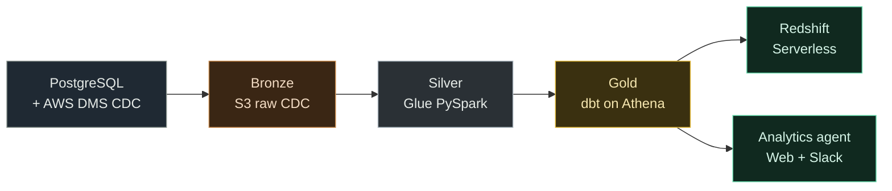

## About

Data Platform Engineer based in Berlin with 5+ years of experience designing and delivering data platforms on AWS, GCP and Databricks.

I own platforms end to end: cloud infrastructure and networking, CDC ingestion, lakehouse modelling, orchestration, serving, observability and CI/CD. I care about clean environment boundaries, reproducible delivery, and systems the next engineer can understand.

**Focus areas:** cloud data platforms · CDC and event-driven ingestion · medallion architecture · analytics engineering · infrastructure as code · applied AI on trusted data

---

## Flagship Build: Enterprise Data Platform on AWS

A multi-repo platform that turns PostgreSQL change events into business-ready analytics, answered in plain English through a browser or Slack.

- **Ingestion:** PostgreSQL RDS with AWS DMS full load and CDC into an immutable S3 Bronze layer
- **Processing:** 6 parallel Glue PySpark jobs reconcile CDC into Silver, with invalid records quarantined
- **Modelling:** 15 tested dbt models on Athena build the Gold layer
- **Serving:** Redshift Serverless, plus a FastAPI/Streamlit analytics agent on ECS Fargate with a Slack gateway
- **Operations:** Step Functions orchestration (MWAA alternative), Terraform across 9 modules, GitHub Actions CI/CD
- **Reliability:** private networking, encryption, least-privilege IAM, data quality gates, CloudWatch alarms and audit logging
- **Efficiency:** a full pipeline run finishes in 10–12 minutes, with cost-aware infrastructure lifecycle

| Repository | Purpose |
|---|---|
| [terraform-platform-infra-live](https://github.com/enterprise-data-platform-emeka/terraform-platform-infra-live) | Networking, storage, processing, serving and orchestration infrastructure |
| [platform-glue-jobs](https://github.com/enterprise-data-platform-emeka/platform-glue-jobs) | Bronze → Silver PySpark jobs with CDC reconciliation and validation |
| [platform-dbt-analytics](https://github.com/enterprise-data-platform-emeka/platform-dbt-analytics) | Silver → Gold dbt models on Athena |
| [platform-analytics-agent](https://github.com/enterprise-data-platform-emeka/platform-analytics-agent) | Natural-language analytics agent with guarded SQL generation |
| [platform-orchestration-mwaa-airflow](https://github.com/enterprise-data-platform-emeka/platform-orchestration-mwaa-airflow) | Airflow implementation of the end-to-end pipeline |

[View the full organisation →](https://github.com/enterprise-data-platform-emeka)

---

## Selected Projects

| Project | Stack | What it shows |
|---|---|---|
| [Databricks Real Estate Pipeline](https://github.com/ChuquEmeka/Databricks_Asset_Bundles_Real_Estate_Data_Pipeline_Youtube) | Databricks, Delta Live Tables, GCP | Medallion lakehouse with Asset Bundles and CI/CD |
| [Real Estate Valuation](https://github.com/ChuquEmeka/real_estate_valuation_dbt_fusion_snowflake_aws_pipeline) | dbt Fusion, Snowflake, S3 | Multi-source valuation pipeline with automated delivery |
| [Healthcare Pipeline on GCP](https://github.com/ChuquEmeka/Airflow-dbt-bigquery-gcs-healthcare-data-pipeline) | Airflow, dbt, BigQuery, GCS | Orchestrated transformation on Google Cloud |
| [Real-Time IoT Pipeline](https://github.com/ChuquEmeka/iot-kafka-bigquery-gcs-real-time-data-pipeline) | Kafka, BigQuery, GCS | Streaming ingestion for analytics |
| [Fraud Detection Pipeline](https://github.com/ChuquEmeka/DBT-Fraud-Detection-Data-Pipeline) | dbt, Snowflake, S3 | Fraud analytics modelling with CI/CD |
| [Sales Analytics Pipeline](https://github.com/ChuquEmeka/End-to-End-Data-Pipeline-Snowflake-dbt-Tableau) | Snowflake, dbt, Tableau | Incremental star-schema modelling through to BI |

---

## Core Stack

